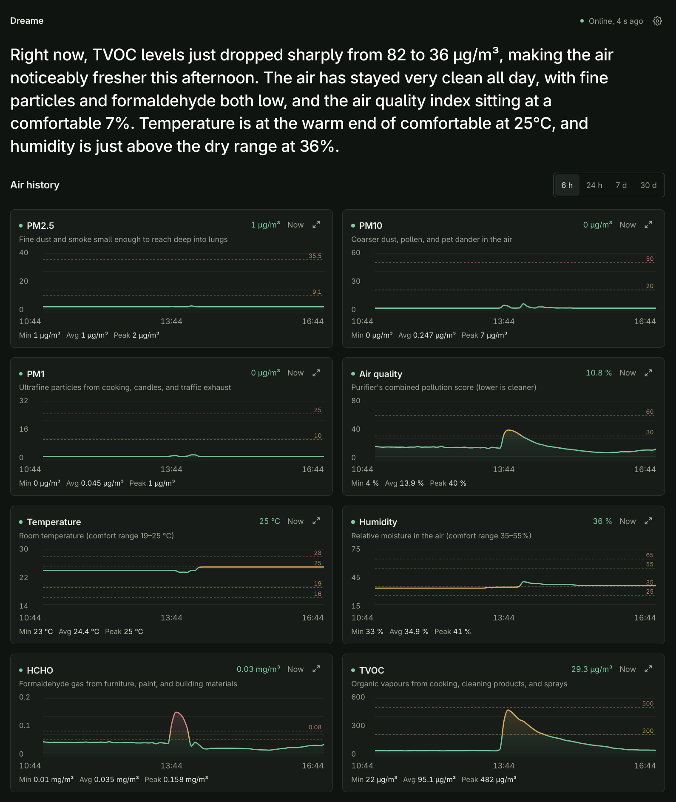

# dreame-dashboard

`dreame-dashboard` (`dmd`) is a self-hosted web dashboard for the Dreame AirPursue PM20 air purifier (`dreame.airp.u2402`). It compiles to one static Go binary using only the Go standard library, polls the Dreame cloud API (with optional MQTT push updates), stores sensor history as local JSONL files, and serves a dark web interface on port `9094`.

Do not forward port `9094` on your router. The interface has no login password unless you enable HTTP Basic auth.



## What it shows and controls

The Overview page (`/`) displays current PM2.5, air quality status (or Standby when the unit is off), and live readouts for PM1, PM2.5, PM10, HCHO, TVOC, temperature, and relative humidity. Below the summary are eight individual metric charts with `6h`, `24h`, `7d`, and `30d` spans, hover scrubbing, and a zoom dialog. All pages receive live updates over Server-Sent Events (`/events`).

The Device page (`/device`) shows remaining HEPA and activated carbon filter life (percentage and days left), hardware identity, Wi-Fi and LAN telemetry, firmware version and cloud OTA update checks, runtime settings, and device controls. Supported PM20 controls are Power (Working/Standby), Mode (`AI`, `Comfort`, `Custom`, `Pet`), Fan speed (`1` to `10`), Oscillation (`Off`, `45°`, `90°`, `180°`), Heater (`Off` or `18` to `40 °C`), Follow motion, Nearby power-on, and Continuous monitoring. Every device write uses a two-step confirmation bar and checks the expected previous value before sending.

The Activity page (`/activity`) keeps a searchable log of issued commands, state changes, and sync errors for the last `1`, `7`, or `30` days.

Optional OpenAI integration adds hourly 24-hour summaries on `/` and on-demand per-metric reports inside the chart zoom dialog. You can supply an OpenAI API key through `DMD_OPENAI_API_KEY_FILE` or save one in `/device`, where it is stored encrypted at rest with AES-256-GCM.

## Quick start

Create a `data` directory owned by your container user (`1000:1000` by default) and start the container with Docker Compose:

```sh
mkdir -p data
docker compose up -d
```

Open `http://<host>:9094/` on your LAN and sign in with your Dreame account email, password, and region (`us`, `eu`, `cn`, `sg`, `kr`, or `ru`). Interactive sign-in writes only the OAuth access and refresh tokens to `./data/tokens.json` (mode `0600`) and discards the password.

For unattended sign-in across expired refresh tokens, put the password in `./secrets/dreame.pw` (mode `0600`, owned by `1000:1000`), uncomment `DMD_EMAIL`, `DMD_PASSWORD_FILE`, and the `./secrets:/secrets:ro,Z` mount in `docker-compose.yml`, and restart the container. Copy `.env.example` to `.env` if you want to override `TZ`, `DMD_REGION`, `DMD_UID`, `DMD_GID`, or `DMD_IMAGE` without editing `docker-compose.yml`.

## Enabling device controls

Controls stay read-only until `dmd` verifies the device's writable properties and records `verified_by: "write-probe"` in `/data/device_profile.json`. Run the probe once while you are near the purifier:

```sh
docker compose exec dreame-dashboard /usr/bin/dmd probe-writes --yes-actuate
```

`probe-writes` snapshots writable properties, exercises mode, fan speed, oscillation, toggles, and power (`Action(2, 1)`), and restores the previous state on exit or interruption. It never energizes the heater (`2.6`) and never calls factory reset (`Action(2, 3)`).

To refresh the read-only property map without actuating anything, run:

```sh
docker compose exec dreame-dashboard /usr/bin/dmd verify-map
```

## Settings and environment variables

`DMD_READ_ONLY=true` locks out all device writes and disables the write-access toggle in `/device`. Otherwise, settings saved in `/device` (poll interval, temperature unit, and write access) override environment values until you click Reset to defaults. Sensor history is always recorded in Celsius and converted only for display.

Unknown `DMD_*` environment variables stop the process at startup so typos do not go unnoticed.

| Variable | Default | Notes |
| :--- | :--- | :--- |
| `TZ` | `UTC` | IANA timezone for timestamps and chart ticks |
| `DMD_LISTEN` | `0.0.0.0:9094` | HTTP bind address and port |
| `DMD_DATA_DIR` | `/data` | Persistent directory for state, tokens, and JSONL history |
| `DMD_RUN_DIR` | `/run/dmd` | Runtime directory for `status.json` and `ctl.sock` |
| `DMD_REGION` | `us` | Dreame cloud region (`us`, `eu`, `cn`, `sg`, `kr`, `ru`) |
| `DMD_COUNTRY` | derived | Two-letter ISO country code; defaults from `DMD_REGION` |
| `DMD_TENANT` | `000000` | Six-digit Dreame tenant ID |
| `DMD_EMAIL` | empty | Dreame account email; required when a password is set |
| `DMD_PASSWORD_FILE` | empty | Path to Dreame password file; conflicts with `DMD_PASSWORD` |
| `DMD_PASSWORD` | empty | Plaintext Dreame password; prefer `DMD_PASSWORD_FILE` or web login |
| `DMD_DID` | empty | Device ID to monitor when an account has multiple purifiers |
| `DMD_POLL_INTERVAL` | `30s` | HTTP polling interval (`20s` to `300s`) |
| `DMD_MQTT_POLL_INTERVAL` | `5m` | Fallback HTTP poll interval while MQTT is connected (`1m` to `30m`) |
| `DMD_BATCH_SIZE` | `10` | Properties per cloud request (`1` to `10`) |
| `DMD_READ_ONLY` | `false` | `true` hard-locks the dashboard to read-only mode |
| `DMD_ENABLE_MQTT` | `false` | Subscribe to Dreame MQTT push messages alongside HTTP polling |
| `DMD_MQTT_CA_FILE` | empty | Custom CA bundle PEM file for the MQTT broker |
| `DMD_MQTT_INSECURE_SKIP_VERIFY` | `false` | Skip TLS certificate verification on MQTT |
| `DMD_SEND_RLC` | `false` | Send the optional `dreame-rlc` header on cloud requests |
| `DMD_RETENTION_DAYS` | `90` | Days of hourly rollups kept in `rollups.jsonl` (`7` to `365`) |
| `DMD_TEMP_UNIT` | `C` | Display temperature unit (`C` or `F`) |
| `DMD_BASIC_USER` | empty | HTTP Basic auth username; requires `DMD_BASIC_PASSWORD_FILE` |
| `DMD_BASIC_PASSWORD_FILE` | empty | Path to HTTP Basic auth password file |
| `DMD_OPENAI_API_KEY_FILE` | empty | Path to OpenAI API key file; locks the UI key input when set |
| `DMD_OPENAI_MODEL` | empty | Default OpenAI model (`gpt-4.1-mini`, `gpt-4.1`, `gpt-4o-mini`, `gpt-4o`, `o4-mini`) |
| `DMD_LOG_LEVEL` | `info` | Structured log level (`info` or `debug`) |

## CLI subcommands

| Command | Purpose |
| :--- | :--- |
| `dmd run` | Start the web server and polling supervisor (default command) |
| `dmd version` | Print binary version and Go runtime version |
| `dmd healthcheck` | Exit `0` when `/run/dmd/status.json` is fresh and healthy |
| `dmd check-refresh` | Test Dreame OAuth token refresh against the cloud API |
| `dmd verify-map` | Sweep properties (`siid 1..14`, `piid 1..30`) and update `device_profile.json` |
| `dmd probe-writes --yes-actuate` | Verify writable controls, restore state, and unlock controls |
| `dmd poll-now` | Ask a running `dmd` instance over `ctl.sock` to poll immediately |

## Security model

The HTTP server rejects non-IP, non-localhost `Host` headers with `421` to prevent DNS rebinding. Every `POST` request checks a per-process CSRF token and strict `Origin`/`Referer` headers, returning `403` on mismatch and fixed `303` redirects on success. Responses carry a strict Content-Security-Policy (`script-src 'self'; style-src 'self'`) with zero inline scripts or inline styles.

The container runs as a non-root user with a read-only root filesystem, all Linux capabilities dropped, `no-new-privileges:true`, and tmpfs mounts for `/run` and `/tmp`. Raw readings are kept for 3 UTC days, hourly rollups for `DMD_RETENTION_DAYS`, and command/event audit logs for 180 days.

## Development and releases

Run unit tests locally with Go 1.27:

```sh
sh scripts/unit.sh
```

Run the isolated container smoke test (builds an image, checks `Host` `421`, CSRF `403`, CSP headers, SSE gate behavior, healthcheck, and `SIGTERM` exit `0` on port `19094`):

```sh
sh scripts/smoke.sh
```

If you build on a separate Docker host over SSH, copy `DMD_HOST=user@docker-host` into a local `.env.remote` file (ignored by Git) and run `scripts/remote.sh test`, `build`, `smoke`, or `up`.

GitHub Actions runs `gofmt`, `go vet`, `go test -race`, `shellcheck`, `scripts/smoke.sh`, and a Trivy vulnerability scan (`HIGH,CRITICAL`, exit code 1) on pushes and pull requests. Pushes to `main` publish multi-arch (`linux/amd64`, `linux/arm64`) `edge` and `sha-<12>` images to `ghcr.io/lostinfuture/dreame-dashboard`. Pushing a semver tag (`v0.1.0` or `0.1.0`) triggers the release workflow, which publishes version tags and moves `latest`. A weekly Monday build refreshes `edge` against updated Alpine packages without moving `latest`. Optional Docker Hub publishing activates when `DOCKER_PASSWORD` is configured in repository secrets.

## License

Licensed under the [Apache License 2.0](LICENSE). This project is independent and not affiliated with or endorsed by Dreame Technology.
